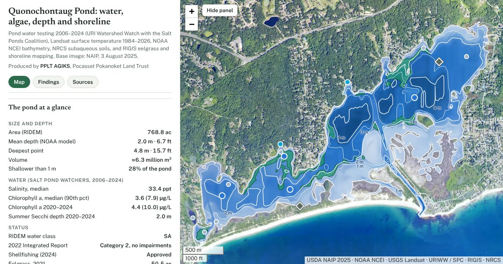

# Quonochontaug Pond: water, algae, depth and shoreline

**Live map: https://ryanpocasset.github.io/QuonochontaugPond/**

An interactive map and analysis of Quonochontaug Pond, a 769-acre coastal salt pond in Westerly and Charlestown, Rhode Island. It covers water testing from 2006 to 2024, algae and its seasonal timing, Landsat surface temperature since 1984, depth and bottom type, eelgrass, shoreline type, and the Quonochontaug Brook inlet at Harmonic Cove.

Produced by **PPLT AGIKS**, Pocasset Pokanoket Land Trust.

[](https://ryanpocasset.github.io/QuonochontaugPond/)

## What it shows

| Finding | Source |
|---|---|
| Algae peak in August–September. Median chlorophyll rose from 2.8 µg/L in 2007–2013 to 4.3 µg/L in 2014–2024 | URI Watershed Watch and the Salt Ponds Coalition: 882 samples from 4 sites |
| The open-water interior now stays above 20 °C for about 98 days a year, against 61 in 1984–1999 | Landsat Collection 2: 659 clear scenes, 1984–2026 |
| Mean depth 2.0 m; deepest point 4.8 m | NOAA NCEI CUDEM topobathy |
| Eelgrass covered 70.6 acres in 2012, 33.5 in 2016 and 50.5 in 2021 | RIGIS eelgrass mapping |
| The brook inlet ran a median 5.8 °C colder than Harmonic Cove on June–September mornings, with 1.7 mg/L nitrate-N | URI Watershed Watch site WW477, 2009–2013 |

The Sources tab on the map lists every source and explains the methods.

## Link to a section

Add one of these to the end of the URL to open a specific view: `#findings`, `#algae`, `#temperature`, `#water`, `#floor`, `#inlet` or `#sources`. For example, https://ryanpocasset.github.io/QuonochontaugPond/#temperature opens the temperature findings.

## Embed it

In ArcGIS StoryMaps, add an **Embed** block and paste the live map URL.

On any other web page:

```html
<iframe src="https://ryanpocasset.github.io/QuonochontaugPond/" title="Quonochontaug Pond map"
        width="100%" height="720" style="border:0" loading="lazy"></iframe>
```

## Publish it

1. Create a public repository named `QuonochontaugPond`. Choose **Add file → Upload files** and drag in everything in this folder, keeping the `base`, `img` and `lib` folders as they are.
2. In **Settings → Pages**, under **Build and deployment**, choose **Deploy from a branch**, then `main` and `/ (root)`, and save.
3. The site goes live at the URL above within a few minutes.

If you use a different repository name, replace `QuonochontaugPond` in this README and in the `og:url` and `og:image` lines of `index.html`. Those two lines only control the preview image when the link is shared. The map itself loads every file by relative path, so it also works from a subfolder of another repository.

## Files

| Path | Contents |
|---|---|
| `index.html` | The page: layout, map, charts and text |
| `data.js` | Map layers and chart data |
| `base/` | NAIP aerial image of 3 August 2025, cut into tiles |
| `img/` | Depth and Landsat temperature overlays |
| `lib/` | Leaflet 1.9.4 map library |
| `preview.jpg` | The screenshot above, also used when the link is shared |
| `.nojekyll` | Optional. Tells GitHub Pages to serve the files as they are |

## Credits

The data come from the public sources listed on the Sources tab: URI Watershed Watch and the Salt Ponds Coalition, RIDEM, RIGIS, NOAA, NRCS, USGS, USDA and EPA. Credit them when you reuse figures or layers. Leaflet is © Volodymyr Agafonkin and contributors, used under the BSD 2-Clause license in `lib/LEAFLET-LICENSE.txt`.

Built November 2026.
